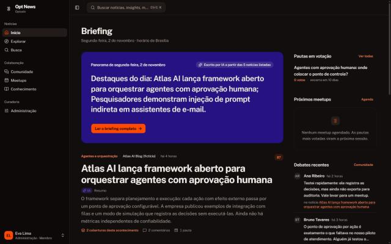
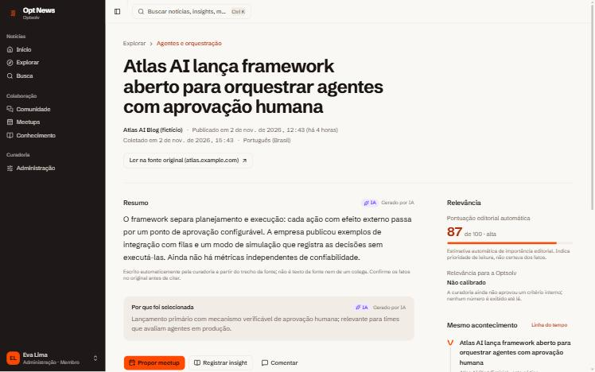
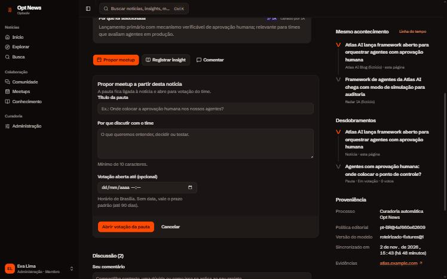
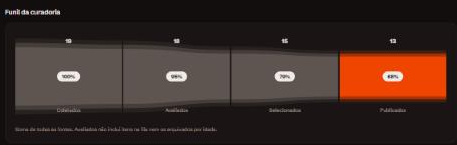
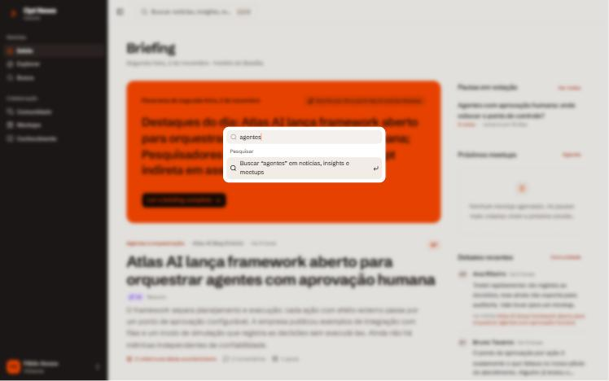
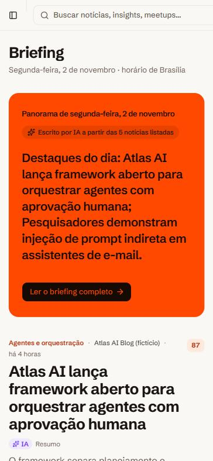
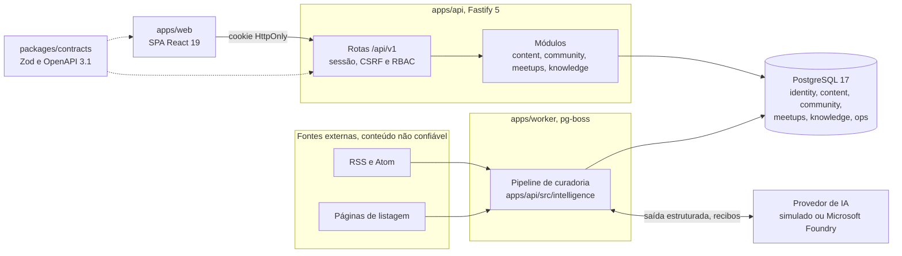
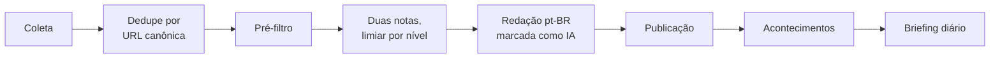

<div align="center">


# Opt News

**Notícias de tecnologia com fonte, debate do time e conhecimento aplicável.**

Plataforma interna de inteligência tecnológica da Optsolv. Coleta fontes oficiais e de imprensa, resume em português com IA marcada como IA e liga cada notícia à discussão, ao meetup e ao aprendizado que ela gerou.

[](docs/16-plano-vertical-slice.md)
[](https://nodejs.org)
[](tsconfig.base.json)
[](apps/web)
[](apps/api)
[](docker-compose.yml)
[](biome.json)
[](#licença-e-créditos)

[Visão geral](#visão-geral) · [Recursos](#recursos) · [Telas](#telas) · [Arquitetura](#arquitetura) · [Começar](#começar) · [Qualidade](#qualidade) · [Documentação](#documentação) · [Roadmap](#status-e-roadmap)

</div>

---

## Visão geral

Times de tecnologia leem muito e guardam pouco. A notícia certa chega por um link solto no chat, rende uma boa conversa e some antes de virar pauta, experimento ou decisão. O Opt News fecha esse ciclo em um só lugar, com proveniência do começo ao fim.

**Jornada essencial:** descoberta → debate → proposta de meetup → apresentação → registro do aprendizado → experimento ou decisão → reuso.

| Pilar | O que entrega |
|---|---|
| **Notícias** | Curadoria automática de IA e tecnologia, com fonte, nota editorial explicada, agrupamento por acontecimento e briefing diário |
| **Comunidade** | Discussão em thread presa à notícia, edição com histórico e moderação auditada |
| **Meetups** | Pauta proposta a partir da notícia, voto único, agenda, materiais e registro pós-sessão |
| **Conhecimento** | Insights com referências validadas e busca que respeita permissões |

Os quatro pilares são obrigatórios e se ligam de forma rastreável: notícia → discussão → meetup → material → conhecimento → experimento.

## Recursos

### Curadoria automática

- **Coleta protegida.** RSS, Atom e páginas de listagem sem feed passam por um fetch com proteção contra SSRF, coleta condicional (`ETag` e `Last-Modified`) e detecção de charset.
- **Seleção em etapas.** Dedupe por URL canônica, pré-filtro, duas notas com limiar por nível de fonte e redação em pt-BR.
- **Custo sob controle.** Cada chamada ao modelo gera um recibo, o reprocessamento não paga duas vezes e há teto diário de chamadas.
- **Acontecimentos.** Coberturas do mesmo fato viram um card só, agrupadas apenas com confiança alta e com cada decisão auditável.
- **Briefing diário.** O panorama é escrito pelo modelo e descartado se citar nome ou número ausente das notícias listadas.

### Proveniência e governança

- Toda notícia mostra fonte, autoria, publicação, coleta e o motivo da seleção.
- Texto gerado por IA leva marca de IA, e a nota editorial diz que indica prioridade, não certeza.
- Só título, trecho e link de terceiros são guardados. O texto integral nunca é armazenado nem exibido ([ADR-0008](docs/12-adrs.md)).
- Curadores revisam a fila, publicam, retiram, publicam mesmo assim e rotulam decisões para calibrar os limiares.
- Administradores cadastram fontes, pausam, retomam e ajustam cadência, com auditoria antes e depois.

### Colaboração

- Comentários em thread com edição versionada e moderação auditada.
- Propostas de meetup a partir da notícia ou manuais, com voto único e idempotente.
- Sessões com estados, materiais e registro do que foi aprendido.
- Insights ligados às notícias e meetups de origem, encontrados pela busca de texto completo do PostgreSQL.

### Experiência

- SPA React 19 com tema claro e escuro, busca rápida com `Ctrl K` e layout responsivo do celular ao desktop.
- Identidade Optsolv aplicada a partir do Brand System oficial, documentada em [DESIGN.md](DESIGN.md).
- Página de apresentação com o símbolo desenhado por pontos em three.js e movimento com GSAP, Lenis, Motion e CSS.
- Todo movimento é desligado com `prefers-reduced-motion`. A meta de acessibilidade é WCAG 2.2 AA.
- Interface em pt-BR e datas no fuso `America/Sao_Paulo`.

## Telas

<table>
  <tr>
    <td width="50%"></td>
    <td width="50%"></td>
  </tr>
  <tr>
    <td align="center"><sub>Briefing do dia, pautas e debates</sub></td>
    <td align="center"><sub>Notícia com proveniência e nota explicada</sub></td>
  </tr>
  <tr>
    <td></td>
    <td></td>
  </tr>
  <tr>
    <td align="center"><sub>Da notícia à pauta de meetup</sub></td>
    <td align="center"><sub>Funil da curadoria</sub></td>
  </tr>
  <tr>
    <td></td>
    <td></td>
  </tr>
  <tr>
    <td align="center"><sub>Busca rápida com Ctrl K</sub></td>
    <td align="center"><sub>Celular</sub></td>
  </tr>
</table>

Mais capturas, em claro, escuro, desktop e celular, estão em [`docs/evidencias`](docs/evidencias).

## Arquitetura

Monólito modular com um worker de conteúdo isolado ([ADR-0004](docs/12-adrs.md)). Cada pilar é um módulo com schema próprio no PostgreSQL, e o contrato HTTP é um pacote compartilhado entre API e web ([ADR-0012](docs/12-adrs.md)).



**Pipeline de curadoria.** Reimplementa a inteligência de seleção do [AIHOT](https://github.com/KKKKhazix/AIHOT) dentro do Opt News, sem consumir o serviço dele ([ADR-0003](docs/12-adrs.md), estratégia D, atribuição em [NOTICE](NOTICE)).



| Camada | Tecnologia |
|---|---|
| Runtime | Node.js 24, que executa TypeScript direto, sem build do backend |
| Linguagem | TypeScript 7 em modo estrito |
| API | Fastify 5, Zod 4, `postgres`, rate limit, CSP |
| Dados | PostgreSQL 17 com migrações SQL `up` e `down`, busca de texto completo |
| Jobs | pg-boss com retry exponencial e fila de falhas visível |
| IA | Provedor simulado por padrão; Microsoft Foundry com autenticação Entra, sem chave ([ADR-0013](docs/12-adrs.md)) |
| Web | React 19, React Router 8, Vite 8, Tailwind 4, shadcn/ui e Radix |
| Movimento | CSS (scroll-driven, View Transitions), Web Animations, GSAP, Lenis, Motion e three.js |
| Qualidade | Biome, `node:test`, OpenAPI gerado do contrato |
| Ambiente | Docker Compose para banco, feeds sintéticos, API e worker |

## Começar

### Requisitos

- Node.js 24.11 ou mais novo
- Docker, para o PostgreSQL 17

Tudo roda na máquina. As fontes são feeds sintéticos, o modelo é simulado e o login usa personas fictícias. Nenhum serviço pago é chamado.

### Primeira execução

```bash
npm install --ignore-scripts
```

```bash
cp .env.example .env
```

```bash
npm run db:up
```

```bash
npm run db:migrate
```

```bash
npm run db:seed
```

Depois, em dois terminais:

```bash
npm run dev:api
```

```bash
npm run dev:web
```

Abra http://localhost:5173 e escolha uma persona. O seed já roda o pipeline de curadoria sobre os feeds sintéticos.

### Demo completa em containers

```bash
docker compose --profile app up --build
```

Sobe banco, feeds sintéticos, worker e a API servindo o web compilado em http://127.0.0.1:8080.

### Personas de desenvolvimento

| Persona | Papéis | Para testar |
|---|---|---|
| Ana Ribeiro | member | Leitura, comentário, proposta, voto e insight |
| Carla Mendes | member, organizer | Decidir pautas, agendar e documentar meetups |
| Diego Faria | member, curator | Curadoria, moderação e saúde das fontes |
| Eva Lima | member, admin | Tudo, inclusive cadastrar e editar fontes |
| Fábio Souza | visitor | Só leitura, recebe 403 ao contribuir |
| Gabi Rocha | member desativada | Login recusado, simula o desligamento |

O login simulado é recusado com `NODE_ENV=production`. A lista completa e os fluxos opcionais, como coleta real e IA real, estão em [README-dev.md](README-dev.md).

### Variáveis de ambiente

| Variável | Padrão | Para que serve |
|---|---|---|
| `DATABASE_URL` | banco local na porta 5433 | Conexão do PostgreSQL |
| `TEST_DATABASE_URL` | banco `optnews_test` | Banco dos testes. O nome precisa terminar em `_test` |
| `AUTH_MODE` | `dev` | Login simulado. `entra` depende do tenant aprovado |
| `MODEL_PROVIDER` | `simulated` | `foundry` usa o modelo real e exige endpoint e deployment |
| `MODEL_DAILY_CALL_LIMIT` | `500` | Teto diário de chamadas ao modelo |
| `ARTICLE_READING` | `false` | Deixa o modelo ler o artigo, sem guardar. Desligado até aprovação de direitos |
| `INGEST_PRIVATE_HOSTS` | `127.0.0.1` | Hosts privados liberados à coleta. Só para feeds locais |
| `SERVE_WEB` | `false` | A API serve o web compilado |

O modelo completo, com comentários, está em [`.env.example`](.env.example). Nenhum segredo, tenant ou endpoint corporativo entra no repositório.

### Scripts

| Comando | O que faz |
|---|---|
| `npm run dev:api` / `dev:web` / `dev:worker` | Sobe API, web e worker em modo de desenvolvimento |
| `npm run db:migrate` / `db:rollback` / `db:seed` | Aplica, desfaz e popula o banco |
| `npm run dev:fake-feeds` | Servidor de feeds sintéticos, inclusive casos adversariais |
| `npm run ingest:once` | Roda uma coleta e curadoria completas |
| `npm run model:check` | Três chamadas de verificação ao modelo real, com material sintético |
| `npm run openapi` | Regenera `docs/openapi-v1.json` a partir do contrato |
| `npm run lint` / `typecheck` / `test` / `build` / `smoke` | Portões de qualidade |

## Estrutura

```text
opt-news/
├── apps/
│   ├── api/           Fastify: módulos dos pilares, sessão, curadoria e migrações SQL
│   ├── web/           SPA React 19 com Vite 8 e Tailwind 4
│   └── worker/        Agendamento da coleta e curadoria com pg-boss
├── packages/
│   └── contracts/     Contrato HTTP em Zod, fonte da API, do OpenAPI e dos tipos do web
├── tools/             Feeds sintéticos, fixtures adversariais, smoke e verificação do modelo
├── docs/              PRD, arquitetura, ADRs, segurança, roadmap, evidências e OpenAPI
├── templates/         Modelos de tarefa de agente e de relatório de spike
├── AGENTS.md          Contrato operacional para agentes de IA
├── DESIGN.md          Sistema visual com a identidade Optsolv
└── docker-compose.yml Ambiente local completo
```

## Qualidade

```bash
npm run lint
```

```bash
npm run typecheck
```

```bash
npm test
```

```bash
npm run build
```

- **Testes de integração reais.** Cada arquivo de teste recria o schema pelas migrações e conversa com um PostgreSQL de verdade.
- **Determinismo.** Fixtures sintéticas e um modelo roteirizado cobrem o pipeline. Nenhum teste depende de LLM real.
- **Casos adversariais.** Os testes cobrem prompt injection, HTML perigoso, SSRF e charset Latin-1.
- **Contrato primeiro.** O OpenAPI 3.1 é gerado do mesmo schema Zod que valida a API e tipa o web.

## Segurança

- Sessão no servidor com cookie `HttpOnly` e `SameSite=Lax`, proteção CSRF e autorização sempre no backend ([ADR-0010](docs/12-adrs.md)).
- Fetch de fontes bloqueia endereços internos na conexão, contra SSRF.
- Conteúdo de fonte é tratado como não confiável, inclusive dentro dos prompts.
- Rate limit, Content Security Policy e auditoria das ações sensíveis.
- Autenticação no Foundry só por Entra, sem chave em arquivo.

Detalhes em [docs/09-seguranca-governanca.md](docs/09-seguranca-governanca.md). Para relatar uma vulnerabilidade, fale direto com o responsável pelo projeto, sem abrir issue pública.

## Documentação

| Documento | Finalidade |
|---|---|
| [AGENTS.md](AGENTS.md) | Regras operacionais, prioridades e limites para agentes |
| [HANDOFF_AGENT.md](HANDOFF_AGENT.md) | Prompt de transferência e primeira missão |
| [DESIGN.md](DESIGN.md) | Sistema visual, movimento e voz da interface |
| [README-dev.md](README-dev.md) | Desenvolvimento local, personas, coleta e IA reais, rollback |
| [00 — Decisões](docs/00-decisoes.md) | Decisões confirmadas, propostas e bloqueios |
| [01 — PRD](docs/01-prd.md) | Personas, requisitos com IDs e resultados esperados |
| [02 — Experiência](docs/02-experiencia-ux.md) | Navegação, jornadas e telas |
| [03 — Arquitetura](docs/03-arquitetura.md) | Arquitetura alvo, fronteiras e integrações |
| [04 — Domínio e dados](docs/04-dominio-dados.md) | Entidades, invariantes e eventos |
| [05 — Fluxos](docs/05-fluxos.md) | Fluxos ponta a ponta, estados e compensações |
| [06 — Contratos de API](docs/06-contratos-api.md) | APIs e eventos versionáveis |
| [07 — Spike do AIHOT](docs/07-aihot-spike.md) | Auditoria do AIHOT e calibração da seleção |
| [08 — Integrações](docs/08-integracoes.md) | Entra ID, Microsoft Graph, Teams, SharePoint, Azure DevOps |
| [09 — Segurança e governança](docs/09-seguranca-governanca.md) | Direitos de conteúdo, privacidade e auditoria |
| [10 — Roadmap e backlog](docs/10-roadmap-backlog.md) | Fases, épicos, histórias e aceites |
| [11 — Testes e operação](docs/11-testes-operacao.md) | Testes, SLOs, pipelines e métricas |
| [12 — ADRs](docs/12-adrs.md) | Registro das decisões de arquitetura |
| [13 — Perguntas abertas](docs/13-perguntas-abertas.md) | Pendências, responsáveis e defaults seguros |
| [14 — Critérios editoriais](docs/14-criterios-editoriais.md) | Política editorial, relevância e taxonomia |
| [15 — Rastreabilidade](docs/15-rastreabilidade.md) | Ligação entre PRD, backlog e testes |
| [16 — Vertical slice](docs/16-plano-vertical-slice.md) | Estado de cada tarefa, com evidência |
| [OpenAPI v1](docs/openapi-v1.json) | Contrato HTTP gerado |

**Para agentes de IA:** leia nesta ordem antes de agir: este README, [HANDOFF_AGENT.md](HANDOFF_AGENT.md), [00 — Decisões](docs/00-decisoes.md), [01 — PRD](docs/01-prd.md), [03 — Arquitetura](docs/03-arquitetura.md) e [07 — Spike do AIHOT](docs/07-aihot-spike.md). As regras completas estão em [AGENTS.md](AGENTS.md).

## Status e roadmap

O **vertical slice 01** está implementado e testado localmente: curadoria automática, feed, notícia com proveniência, acontecimentos, briefing diário, comunidade, meetups, conhecimento, busca, administração de fontes, fila de curadoria e página de apresentação. O estado de cada tarefa, com a evidência, está em [docs/16-plano-vertical-slice.md](docs/16-plano-vertical-slice.md).

**Próximo ciclo**

- [ ] Pipeline de CI no Azure DevOps com lint, typecheck, testes, build, auditoria de dependências e varredura de segredos
- [ ] Testes de navegador com Playwright e verificação de acessibilidade com axe
- [ ] Experimentos e decisões com histórico imutável
- [ ] Consumidor do outbox para notificações e reindexação, com retry e fila de falhas
- [ ] Calibração dos limiares com amostra rotulada pelos curadores
- [ ] Login corporativo com Microsoft Entra ID
- [ ] Observabilidade com OpenTelemetry, painel de jobs e alertas
- [ ] Reagrupamento após correção de notícia e briefings semanal e mensal

**Decisões pendentes.** Lista aprovada de fontes e direitos de uso, teto mensal de custo do modelo, tenant e papéis do Entra, hospedagem e identidade visual final. Enquanto isso valem defaults seguros: feeds sintéticos, provedor simulado, login simulado fora de produção e execução local ([docs/13-perguntas-abertas.md](docs/13-perguntas-abertas.md)).

**Fora do escopo inicial.** Produto público, rede social aberta, monetização, app móvel nativo, chatbot que altera sistemas de clientes, republicação integral de conteúdo de terceiros e rankings competitivos de funcionários.

## Contribuindo

1. Leia [AGENTS.md](AGENTS.md) e as decisões em [docs/00-decisoes.md](docs/00-decisoes.md). Decisão **confirmada** só muda com o responsável. Decisão **proposta** muda com ADR e justificativa.
2. Mude o contrato em `packages/contracts` primeiro e regenere o OpenAPI com `npm run openapi`.
3. Toda regra nova de autorização vive no backend, com teste.
4. Rode `npm run lint`, `npm run typecheck`, `npm test` e `npm run build` antes de abrir o pull request.
5. Registre no pull request os requisitos atendidos, os comandos com resultado, as migrações, o rollback e o impacto em API e custo.

## Licença e créditos

Código proprietário. © 2026 Optsolv. Todos os direitos reservados. Nenhuma licença de código aberto é concedida.

Partes do pipeline de curadoria em `apps/api/src/intelligence/` derivam do [AIHOT](https://github.com/KKKKhazix/AIHOT), sob licença MIT. A atribuição completa e o commit de referência estão em [NOTICE](NOTICE). O nome e o logo do AIHOT não são usados.

A marca, o símbolo e os ativos visuais pertencem à Optsolv e não são licenciados por este repositório.
