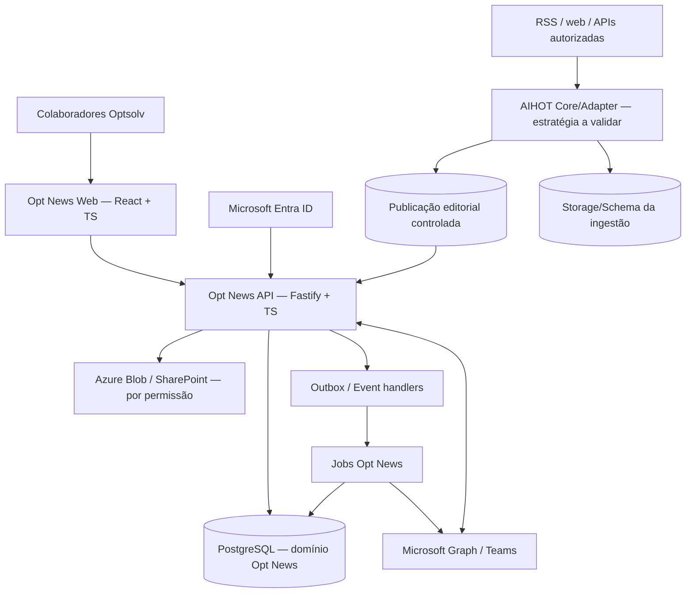

# 03 — Arquitetura alvo e fronteiras

## Princípio

**Separar o domínio de conteúdo/curadoria do domínio colaborativo** e preservar a capacidade de atualizar/substituir o motor AIHOT. Preferência inicial por **monólito modular de negócio + worker de conteúdo isolado**, sujeito a spike/ADR. Não transformar cada pilar em microsserviço sem necessidade.

## Visão lógica



**Atualização 2026-11-02 (ADR-0003, estratégia D):** `ENG` deixou de ser um serviço AIHOT: é o módulo `apps/api/src/intelligence/`, executado pelo worker, com fontes, itens brutos e recibos no schema `content`. O restante do desenho vale como está.

**Legenda:** setas são conceituais; layout final de banco/processos depende de ADR. A API nunca deve depender de tabelas internas não estáveis do AIHOT. Mecanismo de ingestão não chama diretamente endpoints de colaboração.

## Bounded contexts

1. **Content Intelligence:** fontes, conteúdos brutos, extração, deduplicação, pontuação editorial, eventos, relatórios, publicação/retirada.
2. **Identity & Access:** identidade corporativa, papéis, permissões, preferências, sessão.
3. **Community:** comentários, reações, menções, moderação, contribuições.
4. **Meetups:** propostas, votação, sessões, agenda, materiais e histórico.
5. **Knowledge:** insights, experimentos, decisões, referências e recuperabilidade.
6. **Administration & Audit:** curadoria, parâmetros, custos, operações, auditoria e dashboards operacionais.

## Contrato anticorrupção com AIHOT (ACL)

Implementar um adapter que exponha somente objetos estáveis e necessários, sem vazamento de tipos upstream. Exemplo conceitual:

```ts
interface PublishedStoryV1 {
  id: string;
  canonicalUrl: string;
  sourceId: string;
  sourceName: string;
  originalPublishedAt: string | null;
  firstSeenAt: string;
  headline: string;
  summary: string;
  language: string;
  topics: string[];
  editorialScore: number | null;
  evidenceUrls: string[];
  eventId?: string;
  publicationState: 'published' | 'retracted' | 'under_review';
  provenance: { provider: string; upstreamId: string; modelVersion?: string; policyVersion?: string };
}
```

A forma é **proposta**, não contrato já implementado no AIHOT. Validar fontes dos campos, fuso, garantias, IDs e mudanças antes de codificar. Exigir upsert idempotente com `upstreamId + provider` e versionamento no adapter.

## Padrões de dados e eventos

- Postgres com schemas separados por domínio (`content`, `community`, `meetups`, `knowledge`, `identity`, `ops`) **ou** isolamento lógico equivalente conforme ORM e migrações.
- UUIDs internos estáveis; IDs do upstream somente como referências. Foreign keys para entidades internas, links polimórficos somente por tabela de referência com validação.
- Outbox transacional para eventos de negócio importantes; consumidores idempotentes, tentativas com backoff e dead-letter observável.
- Timestamps UTC; `America/Sao_Paulo` na exibição; soft-delete e retenção onde necessário.
- Indexação de busca respeita visibilidade; não criar embeddings de conteúdo confidencial em serviço externo sem aprovação.
- Ações de UI nunca fazem chamadas LLM em request/response crítico. Trabalhadores assíncronos processam e armazenam resultados.

## Topologia de implantação (proposta)

- Opt News Web/API e worker(s) em containers no Azure, dimensionamento após medição.
- Azure Database for PostgreSQL; blob storage para arquivos internos aprovados; Key Vault para segredos; telemetria via stack Azure/OTel.
- CI/CD e repositório operacional em Azure DevOps, com pipelines e ambientes `dev`, `staging`, `prod` após política aprovada.
- Inicialmente não há justificativa técnica automática para AKS/Kubernetes; comparar custo operacional de App Service/Container Apps ao decidir.
- Deixar acesso corporativo protegido; avaliar rede privada, WAF, quotas e política de logs conforme classificação de dados.

## Perfis de falha

- **Coleta cai:** feed serve último conteúdo publicado com timestamps, mostra estado administrativo; usuários continuam colaborando.
- **LLM indisponível:** itens ficam pendentes/reprocessáveis, não se publica resumo inventado; fatura não duplica por retry.
- **Graph falha:** meetup persiste como rascunho com erro explícito e retry seguro; sem afirmar que reunião foi criada.
- **Uma notícia é retirada:** preservar auditoria interna e referencial do histórico, mas restringir exibição do conteúdo retirado; evitar links quebrados sem contexto.
- **Usuário perde acesso:** sessões expiram/revalidam; conteúdo e ações protegidos imediatamente; autoria histórica preservada conforme política.

## Exceções/decisões que exigem ADR

- Fork sincronizado vs extração de pacotes vs engine rodando como serviço isolado.
- Banco único com schemas vs banco separado para motor.
- Autenticação SSR/SPA e cache por usuário.
- Publicação interna por default vs futura abertura controlada de partes públicas.
- Formato de mensagens e estratégia de busca semântica.
