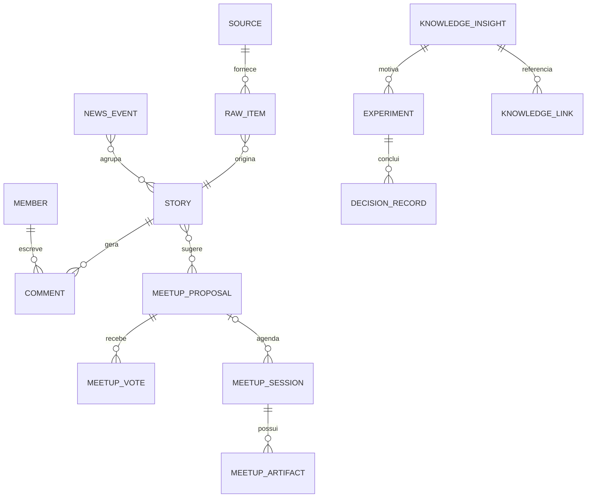

# 04 — Modelo de domínio e dados (conceitual)

> Este documento define **entidades e invariantes**, não o SQL final. Tabelas e colunas devem ser revisadas após o spike AIHOT e escolha de ORM/migração.

## Aggregate roots e campos essenciais

| Entidade | Campos-chave | Regras |
|---|---|---|
| `Source` | id, type, name, baseUrl, tier, licencePolicy, active, cadence | Fonte gerenciável por curador; um dado externo não equivale a fonte autorizada |
| `RawItem` | upstreamId, sourceId, canonicalUrl, contentHash, observedAt, publishedAt, status | Dedupe por URL normalizada/hash; conteúdo completo tem política e prazo próprios |
| `Story` | id, headline, summary, primarySource, publishedAt, editorialScore, optsolvScore, status, analysisVersion | Resumo próprio com proveniência; não republique corpo integral sem autorização |
| `NewsEvent` | id, title, status, heatScore, lastUpdated | Agrupa stories vinculados e mantém histórico |
| `Topic` | id, slug, label, type, aliases | Slugs estáveis; pode representar empresa/tecnologia/assunto |
| `Member` | id, entraOid, tenantId, displayName, status | OID+tenant únicos; PII mínima, sem guardar credenciais |
| `RoleAssignment` | memberId, role, scope, grantedBy | Auditado; permissões no backend |
| `Comment` | id, authorId, targetType, targetId, parentId, body, status, revision | Thread, soft-delete, edição e moderação auditáveis |
| `Reaction` | id, authorId, targetId, type | Política de unicidade por membro/objeto/tipo |
| `MeetupProposal` | id, authorId, title, newsRefs, status, votingClosesAt | Podem surgir por notícia ou manualmente |
| `MeetupVote` | proposalId, memberId, vote | Sem voto duplicado; restrições de janela |
| `MeetupSession` | id, proposalId?, title, scheduledStart, organizerId, presenterIds, state, teamsRef? | ID Teams opcional, não criar reuniões duplicadas |
| `MeetupArtifact` | id, sessionId, kind, fileRef/url, authorId, visibility | Artefatos internos com classificação e retenção |
| `KnowledgeInsight` | id, authorId, title, hypothesis, applicability, status | Conclusão humana distinguida de sugestão IA |
| `Experiment` | id, insightId, ownerId, goal, method, metric, state | Sem execução automática; evidências ligadas |
| `DecisionRecord` | id, experimentId?, conclusion, rationale, decidedBy, decidedAt | Histórico imutável/append-only para decisão final |
| `KnowledgeLink` | id, fromType/id, toType/id, relation | Relação tipada validada entre objetos; rastreabilidade |
| `AuditRecord` | actor, action, target, before/afterRedacted, requestId, timestamp | Sem tokens/PII desnecessária; somente operadores autorizados |
| `Notification` | recipientId, type, target, readAt | Não enviar conteúdo restrito ao destinatário sem autorização |

## Relacionamentos nucleares

A notação de `KnowledgeLink` é simplificada; relações com `Story`, `MeetupSession`, `Comment`, `Experiment` e documentos são registradas por tipo e validadas por serviço.

## Separação entre conteúdo e opinião

`Story` (fonte + resumo IA) ≠ `Comment` (autoria humana) ≠ `KnowledgeInsight` (interpretação/proposta interna) ≠ `DecisionRecord` (decisão aprovada). Nunca sobrescrever uma dessas entidades com outra por conveniência.

## Estados e transições

- `RawItem`: `discovered` → `extracting` → `ready` / `needs_review` / `failed` → `evaluated` → `archived`.
- `Story`: `draft` → `under_review` → `published` → `corrected` / `retracted`. Histórico de mudança preservado.
- `MeetupProposal`: `open` → `selected` / `rejected` / `expired` / `withdrawn`.
- `MeetupSession`: `draft` → `scheduled` → `completed` → `documented` (ou `cancelled`); horário e status independentes da existência de reunião Teams.
- `KnowledgeInsight`: `proposed` → `reviewing` → `accepted` / `dismissed` → `archived`.
- `Experiment`: `proposed` → `approved` → `in_progress` → `completed` / `aborted` → `evaluated`.

## Integridade e acessos

- Comentário e voto exigem usuário ativo com acesso ao objeto-alvo.
- Meeting artifacts podem ter confidencialidade maior que a notícia que originou a pauta.
- Links de conhecimento nunca dão permissões por herança automática: cada destino aplica sua própria política.
- `canonicalUrl` pode mudar por redirecionamento; não usar URL como ID único interno.
- Conteúdo apagado/retraído requer política explícita de busca, retenção e referências quebradas.
- Search index deve verificar visibilidade **antes** de mostrar snippets e contagens.

## Migrações e seed

- Migrações aditivas reversíveis; expand/contract ao alterar contratos; seed só com dados sintéticos e fontes permitidas.
- Nunca importar dados de funcionários/cliente sem autorização.
- Índices candidatos: story(status,published_at), story canonical URL/hashes, topic slug, comment(target,created_at), meetup scheduled_start, knowledge search. Validar em `EXPLAIN ANALYZE`.
